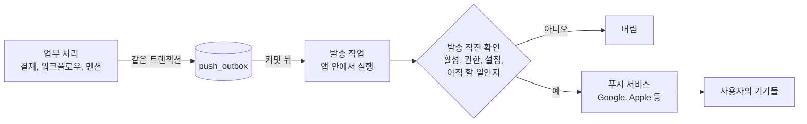

# 알림 기능 기획

2026-11-25 · 기준 문서 [barochannel.md](barochannel.md) · 상태: 0단계(실기기 시험) 화면 개발

## 1. 개요

내가 처리하거나 확인할 일이 생기면 바로채널을 보고 있지 않아도 PC와 휴대폰에 알린다. 표준 **웹 푸시(VAPID)**를 쓰고 네이티브 앱은 만들지 않는다. 휴대폰에서는 홈 화면에 추가한 웹앱(PWA)으로 받는다.

기획서의 "웹 푸시·이메일은 최소화"에 맞춰 **내 할 일에 해당하는 것만** 보낸다. 푸시는 늦거나 빠질 수 있으므로 최종 기준은 계속 **내 할 일**이다.

## 2. 확정한 사항

| # | 내용 | 절 |
| --- | --- | --- |
| 1 | 운영은 iwinv 고정 IP(`https://<IP>`), 시험은 `localhost`. 운영 도메인은 없다 | 4 |
| 2 | 로그인은 쓸 때마다 연장하고 14일 동안 쓰지 않으면 끊긴다. 사용자별 세션 버전을 두어 서버에서 끊을 수 있게 한다 | 7 |
| 3 | 잠금 화면에는 알림 종류와 채널명까지만 보인다. 결재 제목, 본문, 첨부 이름은 싣지 않는다 | 6 |
| 4 | 회사 밖 휴대폰(LTE, 집 와이파이) 접속을 계속 열어 둔다 | 7 |
| 5 | 발생하면 바로 보낸다. 방해 금지 시간과 묶음 발송은 두지 않는다. 밤에는 각자 휴대폰의 방해 금지를 쓴다 | 5 |

남은 결정은 없다(13절).

## 3. 알림 대상

| 종류 | 언제 | 받는 사람 | 기본 |
| --- | --- | --- | --- |
| 결재 차례 | 상신, 앞 단계 승인 | 이번 단계 승인자 | 켬 |
| 검토 요청 | 상신 | 검토자 | 켬 |
| 최종 승인 가능 | 마지막 검토 완료 | 최종 단계 차례인 승인자 | 켬 |
| 결재 결과 | 최종 승인, 반려, 폐기 | 기안자 | 켬 |
| 워크플로우 차례 | 제출, 단계 이동, 담당자 변경, 처리 취소로 되살아난 차례 | 담당자 | 켬 |
| 보완 요청 | 등록 단계로 돌려보냄 | 등록자 | 켬 |
| 워크플로우 결과 | 완료, 반려, 폐기 | 등록자 | 켬 |
| 멘션 | 멘션 추가, 재확인 요청 | 새로 추가됐거나 미확인으로 돌아온 사람 | 켬 |
| 참조 | 상신 | 참조자 | 끔 |
| 수신 대기 | 발신 | 수신할 수 있는 사람 | 끔 |

- 보내지 않는다: 채널 새 글, 답글, 반응, 투표, 문서 수정, 임시저장, 회수와 기안 취소.
- 본인의 행동은 본인에게 알리지 않는다.
- 최종 승인자의 차례 알림은 검토가 끝나 실제로 승인할 수 있을 때 보낸다(F-73). 검토가 남아 있으면 **최종 승인 가능**으로 한 번만 간다.
- 글을 고쳐 멘션이 그대로면 다시 보내지 않는다.
- 같은 사람에게 같은 글로 여러 종류가 겹치면 처리할 일이 있는 쪽 하나만 보낸다.

## 4. 환경

| 환경 | 주소 | 웹 푸시 | 비고 |
| --- | --- | --- | --- |
| 운영 | `https://<iwinv IP>` | 가능해야 한다(실기기 확인 필요) | Let's Encrypt IP 인증서 |
| 시험 | `http://localhost:8000` | PC만 | `localhost`는 HTTPS가 아니어도 허용된다. 휴대폰은 PC의 localhost에 들어올 수 없다 |
| QNAP 1차 | `http://192.168.0.114:8000` | 불가 | HTTPS가 아니다. 배포도 보류 중 |

**고정 IP 운영에서 지킬 것**

- **인증서:** IP 인증서의 유효 기간은 160시간(약 6일)이다. 갱신이 멈추면 접속과 알림 열기가 함께 막힌다. 남은 기간이 48시간보다 짧으면 알아챌 수 있게 점검한다.
- **IP 변경 금지:** 설치한 웹앱과 구독은 접속 주소에 묶인다. IP가 바뀌거나 나중에 도메인으로 옮기면 전원이 홈 화면에 다시 추가하고 알림을 다시 허용해야 한다.
- **키 분리:** VAPID 키는 운영과 시험에서 따로 만든다. 운영 키를 잃으면 전원이 다시 구독해야 하므로 백업한다.
- **나가는 통신:** 서버에서 푸시 서비스로 나가는 443이 열려 있어야 한다.
- **휴대폰 시험:** localhost로는 할 수 없다. 운영 서버에서 시험 계정으로 한다.

## 5. 설계

지금의 개수 신호(`publish_counts`)는 푸시에 쓰지 않는다. 이유가 없고, 개수가 줄 때와 본인이 처리했을 때도 나가기 때문이다.

**데이터**

| 테이블 | 칼럼 |
| --- | --- |
| `push_subscription` | id, user_id, endpoint(고유), p256dh, auth, device_label, session_version, created_at, last_seen_at |
| `push_outbox` | id, user_id, kind, post_id, actor_id, dedupe_key(고유), attempts, next_attempt_at, sent_at, dropped_reason, created_at |
| `push_preference` | user_id, kind, enabled. 행이 없으면 3절의 기본값 |
| `user` | `session_version` 추가 |

- 기존 `notification`은 결재·워크플로우 결과의 개수에 계속 쓴다. 멘션과 결재 차례는 원본 테이블이 기준이므로 옮겨 담지 않는다.
- `dedupe_key`는 같은 차례를 두 번 보내지 않되, 승인 취소 뒤 다시 온 차례나 다음 회차는 새로 보낼 수 있게 만든다.

**발송 작업**

- 앱 `lifespan`에서 시작하고 `FOR UPDATE SKIP LOCKED`로 꺼낸다. Redis나 별도 컨테이너는 두지 않는다.
- 커밋 때 NOTIFY로 깨우고, 놓친 것은 주기적으로 확인한다. 롤백된 일은 나가지 않고 재시작해도 남는다.
- 외부 호출 중에는 DB 트랜잭션을 열어 두지 않는다. 그래서 중단 시 드물게 두 번 갈 수 있고, 같은 `tag`로 화면에서 겹치지 않게 한다.
- 404·410은 구독을 지우고, 429·5xx는 간격을 늘려 다시 보낸다. 하루가 지나면 버린다.
- `Urgency: high`로 보낸다. 보낸 기록은 30일 뒤 지운다.

**화면과 서비스 워커**

- `/sw.js`를 별도 경로로 내고 캐시하지 않는다. `/static`은 1년 캐시이고 범위도 `/static` 아래로 제한된다.
- 받은 푸시는 **반드시** 화면에 표시한다. WebKit은 표시하지 않은 푸시가 3회면 구독을 지운다.
- 누르면 `/approvals/{글}`, `/flows/{글}`, `/posts/{글}`을 연다. 이미 열린 창이 있으면 그 창을 쓴다.
- 앱을 열 때마다 구독이 살아 있는지 확인해 다시 등록한다.
- **전체 → 내 계정 → 알림** 화면에 이 기기 켜기, 기기 목록과 삭제, 종류별 켬/끔, 시험 발송, 설치 안내를 둔다.

**휴대폰**

- iPhone은 iOS 16.4 이상에서 홈 화면에 추가한 뒤에만 받을 수 있다. 권한은 **알림 켜기** 버튼을 눌렀을 때만 묻는다. 거부하면 설정 앱에서 풀어야 하므로, 먼저 안내를 보여준 뒤 묻는다.
- 홈 화면 앱은 Safari와 로그인이 따로다. 추가한 뒤 한 번 더 로그인한다.
- 카카오톡 안의 브라우저로 열면 Safari나 Chrome으로 열도록 안내한다.

## 6. 알림 문구

제목은 종류, 내용은 채널명이다. 예: `결재 차례입니다` / `구매 결재`. 보낸 사람, 제목, 본문은 싣지 않는다.

발송 직전에 권한을 다시 확인하므로, 권한을 잃은 사람에게는 채널명도 가지 않는다.

## 7. 보안과 로그인

- **로그인 연장:** 지금은 쿠키가 다시 발급되지 않아 쓰는 중에도 12시간 뒤 끊긴다. 하루에 한 번 다시 발급하고 14일로 늘린다.
- **서버에서 끊기:** 쿠키에 `session_version`을 넣고 요청과 SSE에서 `user`의 값과 비교한다. 비밀번호 변경, 관리자의 비밀번호 초기화, **모든 기기에서 로그아웃** 때 올린다. 이때 그 사람의 구독도 지운다.
- **로그인 시도 제한:** 지금은 없다. 인터넷에 열린 서버이고 로그인이 오래 유지되므로 계정과 IP별로 제한한다.
- **로그인 뒤 원래 주소:** 지금은 항상 홈으로 간다. 이 사이트 안의 경로만 허용해 돌려보낸다(다른 사이트로 보내는 주소는 무시).
- **구독 주소:** 클라이언트가 보내는 값이다. Google, Apple, Mozilla, Microsoft의 푸시 호스트와 HTTPS만 허용하고 리다이렉트를 따르지 않는다(SSRF).
- **기기 소유자:** 로그아웃하면 그 기기의 구독을 지운다. 같은 기기에서 다른 사람이 로그인하면 이전 사람의 구독을 끊는다.
- **비활성 사용자:** 보내지 않고 구독을 지운다.
- **VAPID `sub`:** 푸시 서비스에 전달되는 연락처다. 형식이 틀리면 Apple이 거부하므로 실제로 받는 업무용 `mailto:` 주소를 쓴다.

## 8. 설정

| 환경 변수 | 뜻 |
| --- | --- |
| `BARO_VAPID_PRIVATE_KEY` | 비우면 푸시를 끈다. 화면에서도 알림 메뉴를 감춘다 |
| `BARO_VAPID_SUBJECT` | `mailto:`로 시작하는 연락처 |
| `BARO_SESSION_MAX_AGE_SECONDS` | 기본값을 14일로 바꾼다 |

공개키는 개인키에서 만든다. 키는 `barochannel-admin vapid-key`로 만든다. 암호화와 서명은 `http-ece`, `py-vapid`(함께 `cryptography`)를 쓰고 발송은 기존 `httpx2`로 한다. `pywebpush`는 리다이렉트를 막을 수 없고 `aiohttp`, `requests`가 함께 들어와 쓰지 않는다.

## 9. 요구사항

| ID | 요구사항 | 차수 |
| --- | --- | --- |
| F-134 | 로그인 연장(14일), 세션 버전, 모든 기기에서 로그아웃 | 1차 |
| F-135 | 로그인 뒤 원래 주소로 이동 | 1차 |
| F-136 | 로그인 시도 제한 | 1차 |
| F-137 | 기기 구독 등록·해제, 기기 목록 | 1차 |
| F-138 | 서비스 워커의 알림 표시와 열기 | 1차 |
| F-139 | 아웃박스, 발송 작업, 재시도, 만료 구독 정리 | 1차 |
| F-140 | 결재 알림(차례, 검토, 최종 승인 가능, 결과, 참조, 수신) | 1차 |
| F-141 | 워크플로우 알림(차례, 보완, 결과) | 1차 |
| F-142 | 멘션과 재확인 알림 | 1차 |
| F-143 | 종류별 켬/끔, 시험 발송 | 1차 |
| F-144 | iPhone·Android 설치 안내 | 1차 |
| F-145 | 앱 아이콘 배지, 메일 요약 | 2차 |

## 10. 기존 코드에서 고칠 곳

| 위치 | 바꿀 것 |
| --- | --- |
| `core/sessions.py`, `core/deps.py`, `routers/events.py`, `models/org.py` | 로그인 연장, 세션 버전. SSE는 `current_user`를 거치지 않으므로 따로 확인한다 |
| `main.py` `login_required`, `routers/auth.py`, `login.html` | 원래 주소, 시도 제한, 로그아웃 때 구독 삭제 |
| `main.py` | `/sw.js`, 발송 작업의 시작과 종료 |
| `routers/approvals.py` | `submit`, `approve`, `reject`, `discard`, `cancel`, `receive`, `review`에서 아웃박스에 넣는다. `review`는 지금 개수 신호도 본인에게만 보낸다 |
| `services/dispatch.py` `send` | 수신 대기 |
| `services/flows.py` | `submit`, `complete`, `send_back`, `reject`, `cancel`, `reassign`, `discard`. 지금 돌려주는 `changed`는 줄어든 사람도 섞여 있어 새 차례를 구분한다 |
| `services/mentions.py` `sync_mentions` | 추가와 삭제를 합쳐 돌려준다. 추가된 사람을 구분한다 |
| `routers/posts.py` `request_reconfirm` | 재확인 요청 |
| `more.html`, `app.js`, `site.webmanifest` | 알림 화면, 구독, 매니페스트 `id` |

## 11. 개발 순서

| 순서 | 내용 | 끝났다는 기준 | 추정 |
| --- | --- | --- | --- |
| 0. 확인 | 운영 IP에서 시험용 최소 페이지로 구독과 수신 | iPhone, 삼성, PC가 IP 주소로 알림을 받는다. **안 되면 멈추고 도메인을 다시 정한다** | 0.5일 |
| 1. 로그인 | F-134~136 | 알림 주소로 들어와 로그인하면 그 글이 열린다 | 2~2.5일 |
| 2. 구독 | 테이블, 구독 API, 서비스 워커, 알림 화면 | 시험 발송이 온다 | 2.5~3일 |
| 3. 발송 | 아웃박스, 발송 작업, 결재·워크플로우·멘션 연결 | 3절의 모든 종류가 맞는 사람에게 간다 | 3일 |
| 4. 시험 | 자동 시험, 실기기, 안내 문구 | 12절 통과 | 1.5~2.5일 |

합계 9.5~11.5일(1명, 추정). 3단계까지 개발이 끝났으므로 4단계 시범 운영 전에 넣는다.

## 12. 시험 항목

- **대상:** 본인 제외, 새로 멘션된 사람만, 검토가 남은 최종 승인자 제외, 마지막 검토 뒤 한 번, 승인 취소 뒤 다시 온 차례.
- **발송 직전:** 이미 처리한 일, 권한을 잃은 글, 삭제된 글, 비활성 사용자, 사용 중지한 채널 유형, 끈 종류는 보내지 않는다.
- **정합성:** 롤백되면 나가지 않음, 발송 작업 둘이 같은 건을 꺼내지 않음, 재시작 뒤 이어서 발송.
- **구독:** 404·410 삭제, 429·5xx 재시도, 허용하지 않은 주소 거부, 로그아웃과 사용자 바뀜.
- **로그인:** 연장, 14일 만료, 세션 버전 불일치 시 요청과 SSE 차단, 다른 사이트로 보내는 주소 거부, 시도 제한.
- **문구:** 제목, 본문, 보낸 사람이 실리지 않음.
- **실기기:** iPhone(홈 화면 앱, 화면 잠금, 앱 종료), 삼성(절전), Windows Chrome·Edge(숨은 탭, 창 닫힘), 인증서 갱신 뒤 수신.

## 13. 남은 결정

없다. 회사 밖 접속은 열어 두기로 했다(2절). 다만 11절 0단계에서 IP 주소로 알림이 오지 않으면 도메인을 다시 정한다.
