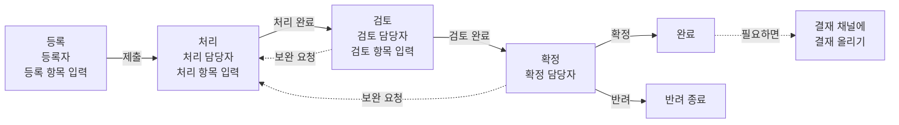
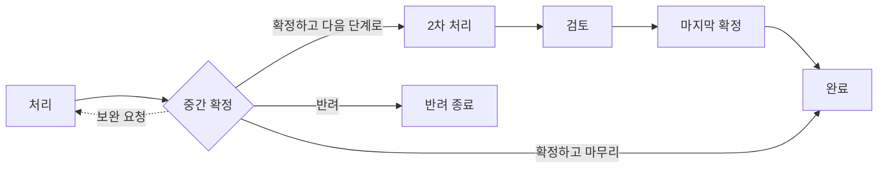
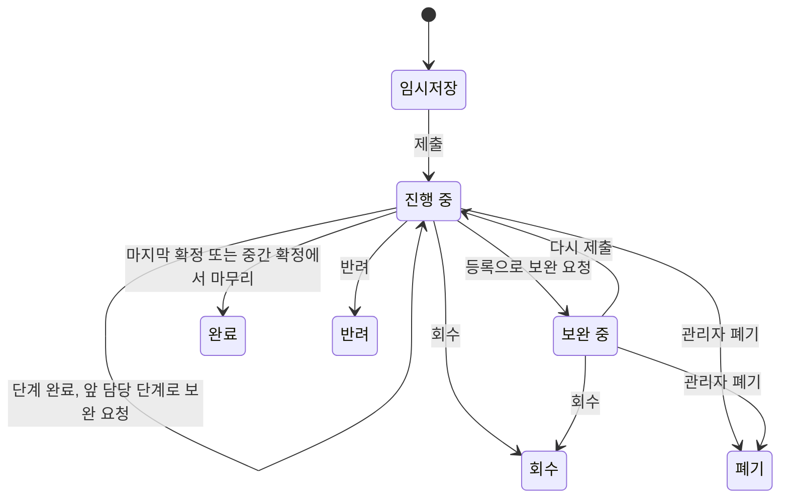

# 워크플로우 채널 기획

2026-11-25 · 기준 문서 [barochannel.md](barochannel.md) · 상태: 1차 개발 완료, 사용자 확인 대기(20절)

## 1. 개요

채널 유형에 **워크플로우**를 더한다. 그룹 관리자가 채널을 만들 때 **단계**, **단계별 입력 항목**, **단계별 담당자**를 화면에서 정하면, 채널의 쓰기 권한자가 그 양식으로 건을 등록하고 담당자가 단계 순서대로 처리한다. 제출한 뒤에 더할 내용은 건의 쓰레드에 남긴다. 코드를 고치거나 배포하지 않고 새 업무 절차를 만들 수 있다.

기본 단계는 **등록 → 처리 → 검토 → 확정**이다. 확정이 끝난 건에 결재가 필요하면 그 건을 바탕으로 결재 채널에 결재를 올린다.



**용어**

| 용어 | 뜻 |
| --- | --- |
| 워크플로우 채널 | 정해 둔 단계와 항목으로 건을 등록하고 처리하는 채널. 여섯 번째 채널 유형(`flow`) |
| 정의 | 채널의 단계와 입력 항목 설정. 발행할 때마다 버전이 오른다 |
| 건 | 정의에 따라 등록한 글 하나. 바로채널의 `post`다 |
| 단계 | 건이 거치는 순서. 등록으로 시작해 확정으로 끝난다 |
| 중간 확정 | 마지막이 아닌 확정 단계. 확정자가 마무리할지 다음 단계로 보낼지 정한다 |
| 입력 항목 | 등록·처리·검토 단계에서 채우는 칸. 필수와 선택을 구분한다 |
| 담당자 | 단계를 맡는 처리자·검토자·확정자. 채널에서 고정하거나 등록자가 지정한다 |
| 보완 요청 | 담당자가 앞 단계로 돌려보내는 것 |
| 회차 | 보완 요청으로 되돌아갈 때마다 1씩 오르는 번호 |
| 추가 내용 | 제출한 뒤 쓰레드에 더하는 정식 내용. 일반 답글과 구분해 건에 모아 보여준다 |

요청서의 "결제"는 기준 문서와 같이 **결재**로 적는다. "확정"은 워크플로우 채널 안의 처리이고, "승인"은 결재 채널의 처리다.

## 2. 확정한 사항

| # | 내용 | 절 |
| --- | --- | --- |
| 1 | 단계는 등록·처리·검토·확정 네 종류다. 등록이 맨 처음, 확정이 맨 마지막이다 | 6 |
| 2 | 중간에도 확정 단계를 둘 수 있다. 중간 확정에서는 확정자가 **마무리**와 **다음 단계로** 중에서 정한다 | 6 |
| 3 | 등록뿐 아니라 처리와 검토 단계에서도 입력할 항목을 채널을 만들 때 지정한다. 확정 단계는 입력 항목 없이 판단과 의견만 남긴다 | 5 |
| 4 | 입력 항목마다 필수 여부를 구분한다 | 5 |
| 5 | 채널은 그룹 관리자가 만들고, 그 채널의 쓰기 권한자가 등록한다 | 4, 7 |
| 6 | 처리자·검토자·확정자는 채널을 만들 때 단계마다 **고정 지정** 또는 **등록자 지정**으로 정한다 | 7 |
| 7 | 최종 확정된 건은 등록자·처리자·검토자·확정자 중 누구나 결재로 올릴 수 있다 | 9 |
| 8 | 결재에 넣은 사본은 상신 전까지 기안자가 고칠 수 있다. 원본과는 링크로 비교한다 | 9 |
| 9 | 제출한 뒤 추가되어야 할 내용은 쓰레드를 쓴다 | 10 |
| 10 | 등록자는 채널 읽기 권한자 중에서 담당자를 지정한다. 단계마다 명단으로 좁힐 수 있다 | 7 |
| 11 | 중간 확정에서 마무리한 건도 결재로 올린다 | 9 |
| 12 | 추가 내용은 고치거나 지울 수 없다 | 10 |
| 13 | 확정 단계에서 돌려보내면 앞 단계에 이미 작성한 내용은 고칠 수 없고 추가만 한다 | 8 |

## 3. 결재·업무 채널과의 구분

| | 결재 | 업무 | 워크플로우 |
| --- | --- | --- | --- |
| 쓰는 일 | 지출·휴가·품의 등 정식 승인 | 외부 시스템 처리 | 접수하고 처리해서 확인받는 부서 업무(자료 검수, 요청 처리, 홍보물 확인 등) |
| 입력 양식 | 제목 + 마크다운 본문 | 화면마다 코드로 개발 | 단계별 항목을 채널에서 설정 |
| 절차 | 소속별 승인선, 기안자가 수정 가능 | 외부 시스템이 정함 | 단계를 채널에서 설정, 모든 건에 같게 적용 |
| 담당자 | 채널과 기안 소속 기준 | 외부 시스템이 정함 | 채널에서 고정 또는 등록자 지정 |
| 되돌리기 | 반려 후 참조 상신(새 문서) | 해당 없음 | 보완 요청 후 같은 건에서 다시 진행 |
| 정식 승인 | 있음 | 없음 | 없음. 필요하면 결재 채널로 넘긴다 |

업무 처리와 확인은 워크플로우 채널에서, 회사 규정상 남겨야 하는 승인은 결재 채널에서 한다. 9절의 연계가 둘을 잇는다.

## 4. 채널 만들기

1. 그룹 관리자가 그룹 설정에서 유형을 **워크플로우**로 골라 채널을 만든다. 만들면 바로 **워크플로우 설정** 화면이 열린다.
2. 기본 단계(등록 → 처리 → 검토 → 확정)가 들어 있다. 단계를 더하거나 뺀다.
3. 등록·처리·검토 단계의 입력 항목을 지정하고 필수 여부를 정한다.
4. 처리·검토·확정 단계마다 담당자를 **고정 지정**할지 **등록자가 지정**하게 할지 정한다.
5. 결재 연계를 쓸지 정한다.
6. **미리보기**로 단계별 화면을 확인하고 **발행**한다. 발행해야 **새 등록**이 열린다. 그 전에는 "아직 준비 중인 채널입니다"로 보인다.

```
워크플로우 설정                                       초안 (발행 전)
┌ 단계와 입력 항목 ─────────────────────────────────────────┐
│ 1 등록  (맨 처음 고정)                                     │
│     제목 · 한 줄 글 · 필수                                  │
│     내용 · 여러 줄 글 · 필수                     [수정][빼기] │
│     첨부 · 파일 · 선택                          [수정][빼기] │
│     [+ 항목 추가]                                          │
│ 2 처리  고정: 김총무, 이총무 · 한 명 완료          ↑↓ [수정][빼기] │
│     처리 내용 · 여러 줄 글 · 필수                [수정][빼기] │
│     결과 파일 · 파일 · 선택                      [수정][빼기] │
│     [+ 항목 추가]                                          │
│ 3 검토  등록자 지정 · 전원 완료                   ↑↓ [수정][빼기] │
│     검토 의견 · 여러 줄 글 · 필수                [수정][빼기] │
│     [+ 항목 추가]                                          │
│ 4 확정  (맨 마지막 고정)  등록자 지정(명단: 최확정, 정확정)  [수정]      │
│ [+ 중간 단계 추가: 처리 | 검토 | 확정]                       │
├ 결재 연계 ────────────────────────────────────────────────┤
│ [v] 완료한 건을 결재로 올릴 수 있다   결재 채널: 지출결의(기본), 품의 │
└───────────────────────────────────────────────────────────┘
[초안 저장]  [미리보기]  [발행]
```

**발행할 때 검사하는 것**

- 첫 단계는 등록 하나, 마지막 단계는 확정이다.
- 고정 지정 단계에는 활성 담당자가, 지정 범위를 명단으로 둔 단계에는 명단에 활성 사용자가 한 명 이상 있다.
- 선택 항목에 선택지가 있다.
- 단계는 12개, 항목은 단계마다 20개를 넘지 않는다.

**발행한 뒤에 바꿀 때**

| 바꾸는 것 | 적용 |
| --- | --- |
| 단계, 입력 항목 | 초안을 고쳐 다시 발행한다. 새로 제출하는 건부터 적용되고, 진행 중인 건은 제출할 때의 판을 끝까지 따른다 |
| 고정 담당자 | 발행 없이 바로 저장된다. 진행 중인 건도 **아직 시작하지 않은 단계**부터 새 담당자가 맡는다. 이미 시작한 단계는 담당자 변경(8절)으로 바꾼다 |
| 등록자 지정의 명단 | 발행 없이 바로 저장된다. 새로 제출하거나 다시 제출하는 건부터 적용되고, 이미 지정한 담당자는 그대로다 |
| 고정 지정과 등록자 지정의 전환, 지정 범위(채널 사용자·명단), 완료 조건 | 초안을 고쳐 다시 발행한다 |
| 결재 연계 | 발행 없이 바로 저장된다 |

이전 판으로 진행 중인 건이 남아 있으면, 새 판에서 뺀 단계의 고정 담당자도 설정 화면에 "이전 판 단계"로 남아 바꿀 수 있다.

## 5. 입력 항목

등록·처리·검토 단계마다 따로 지정한다. 확정 단계는 입력 항목 없이 판단과 의견만 남긴다. 등록의 **제목**은 모든 정의에 있고 뺄 수 없다. 목록, 검색, 내 할 일에 쓰인다.

| 종류 | 입력 | 설정 | 값 제한 |
| --- | --- | --- | --- |
| 한 줄 글 | 글자 | 안내 문구 | 200자 |
| 여러 줄 글 | 마크다운 편집기 | 안내 문구, 기본 형식 | 10,000자 |
| 숫자 | 숫자 | 단위, 최소·최대, 소수 자릿수 | 15자리 |
| 날짜 | 날짜 | 없음 | `YYYY-MM-DD` |
| 선택 | 하나 고르기 | 선택지 50개까지 | 선택지 중 하나 |
| 여러 개 선택 | 여러 개 고르기 | 선택지 50개까지 | 선택지 중에서 |
| 체크 | 확인란 | 확인 문구 | 예·아니오 |
| 파일 | 첨부 | 없음 | 파일당 20MB, 한 번 제출하거나 처리할 때 10개(기존 첨부 설정) |
| 사람 | 사용자 찾기 | 여러 명 허용 | 활성 사용자, 20명 |

**필수와 선택**

- 항목마다 필수 여부를 정한다. 필수 항목은 이름 옆에 "필수"로 보인다.
- 등록의 필수 항목은 **제출**할 때, 처리·검토의 필수 항목은 **완료**할 때 검사한다. 비어 있으면 그 칸 아래에 알려 주고 진행을 막는다. 서버도 같은 검사를 한다.
- 파일은 한 개 이상, 여러 개 선택은 하나 이상, 체크는 체크해야 채운 것으로 본다.
- 임시저장, 보완 요청, 반려에는 필수 검사를 하지 않는다.

**값이 쌓이는 방식**

- 앞 단계의 값은 다음 담당자에게 읽기 전용으로 보인다. 각자 자기 단계의 항목만 입력한다.
- 전원 완료 단계에서는 담당자마다 항목을 따로 채운다. 예: 검토자 두 명이 각자 검토 의견을 쓴다.
- 완료한 값은 잠긴다. 처리 취소나 처리·검토 단계의 보완 요청으로 차례가 돌아오면 이전 값이 채워진 채 다시 열린다. **확정 단계가 보완 요청을 하면 이전 값은 계속 잠겨 있고 추가만 한다(8절).**
- 항목마다 바뀌지 않는 키를 준다. 이름을 바꿔도 값이 이어진다.
- 여러 줄 글은 기존 마크다운 정제를 거친다. 항목 안의 `@이름`은 멘션으로 처리하지 않는다. 알릴 사람은 쓰레드에서 멘션한다.
- 완료한 값을 고치지 않고 내용만 더할 때는 쓰레드의 추가 내용을 쓴다(10절).

## 6. 단계

| 종류 | 자리 | 하는 일 | 입력 항목 | 버튼 |
| --- | --- | --- | --- | --- |
| 등록 | 맨 처음, 하나 | 건을 작성해 제출한다 | 있음 | 임시저장, 제출 |
| 처리 | 중간 | 실제 일을 하고 결과를 남긴다 | 있음 | 처리 완료, 보완 요청 |
| 검토 | 중간 | 내용과 결과를 확인한다 | 있음 | 검토 완료, 보완 요청 |
| 확정(중간) | 중간 | 마무리할지 더 진행할지 판단한다 | 없음 | 확정하고 마무리, 확정하고 다음 단계로, 보완 요청, 반려 |
| 확정(마지막) | 맨 마지막, 하나 | 최종 판단 | 없음 | 확정, 보완 요청, 반려 |

- 중간에는 처리·검토·확정을 순서와 개수에 제한 없이(전체 12단계 안에서) 섞는다. 중간을 모두 빼면 등록 → 확정이다.
- 단계 이름은 자유롭게 정한다(예: "접수 처리", "품질 검토", "1차 확정"). 종류가 버튼과 규칙을 정한다.
- 확정할 때 의견은 선택, 보완 요청과 반려의 사유는 필수다(1,000자).

### 중간 확정

중간 확정의 담당자는 건마다 다음 중 하나를 고른다.



| 선택 | 결과 |
| --- | --- |
| 확정하고 마무리 | 건이 **완료**된다. 남은 단계는 "생략"으로 표시되고 담당자에게 차례가 가지 않는다 |
| 확정하고 다음 단계로 | 다음 단계가 시작된다 |

- 중간 확정으로 마무리한 건도 마지막 확정까지 간 건과 똑같은 완료다. 목록과 건 화면에는 어느 단계에서 마무리했는지 보인다. 결재도 올릴 수 있다.
- **확정하고 마무리**는 되돌릴 수 없으므로 생략되는 단계 이름을 보여주고 한 번 더 묻는다.
- 중간 확정은 먼저 판단한 한 사람의 선택으로 정한다. 여러 명의 선택이 엇갈리지 않게 하기 위해서다.

### 완료 조건

| 조건 | 규칙 | 쓸 수 있는 단계 |
| --- | --- | --- |
| 한 명 | 먼저 완료한 사람으로 끝난다. 나머지는 "처리 불필요"로 남고 할 일에서 빠진다 | 처리, 검토, 확정 |
| 전원 | 모두 완료해야 다음으로 간다. 단계 안에서는 순서가 없다 | 처리, 검토, 마지막 확정 |

보완 요청과 반려는 완료 조건과 상관없이 한 명이 누르면 바로 적용된다.

## 7. 담당자

그룹 관리자가 채널을 만들고, 그 채널의 쓰기 권한자가 등록한다. 처리자·검토자·확정자는 단계마다 아래 두 방법 중 하나로 정한다. 같은 채널에서도 단계마다 다르게 둘 수 있다(예: 처리자는 고정, 검토자와 확정자는 등록자 지정).

| 방법 | 정하는 사람과 때 | 규칙 |
| --- | --- | --- |
| 고정 지정 | 그룹 관리자가 채널 설정에서 | 모든 건을 이 사람들이 맡는다. 단계가 시작될 때 등록된 활성 담당자 모두에게 차례가 간다. 등록 화면에는 이름만 보인다 |
| 등록자 지정(기본) | 등록자가 등록 화면에서 | 지정은 필수다. 임시저장에는 비울 수 있고 제출할 때 검사한다 |

단계마다 담당자는 20명까지다. 등록자의 소속은 담당자에 영향을 주지 않는다.

**등록자가 지정할 수 있는 범위**

| 범위 | 고를 수 있는 사람 | 맞는 경우 |
| --- | --- | --- |
| 채널 사용자(기본) | 그 채널의 읽기 권한이 있는 활성 사용자 | 누가 맡을지 건마다 다를 때 |
| 명단 | 그룹 관리자가 그 단계에 적어 둔 사람 | 확정자처럼 정해진 사람 중에서만 골라야 할 때 |

확정 단계에는 **명단을 권한다.** 채널 사용자 전체에서 고르면 등록자가 아무에게나 확정을 받을 수 있다. 설정 화면에서 이 점을 안내한다. 범위는 서버에서도 검사한다.

**담당자의 권한**

| 담당자 | 받는 권한 |
| --- | --- |
| 고정 담당자, 명단에 있는 사람 | 그 채널의 읽기·답글읽기·답글쓰기. 결재 승인자처럼 사용자·소속의 거부 설정보다 우선한다 |
| 채널 사용자 중에서 지정된 사람 | 맡은 건의 읽기·답글읽기·답글쓰기. 지정된 뒤 채널 읽기 권한을 잃어도 맡은 건은 볼 수 있다 |
| 등록자 | 자기 건의 읽기·답글읽기·답글쓰기. 쓰기 권한만 있어도 쓰레드를 쓸 수 있다 |

새 등록에 필요한 쓰기 권한은 담당자라고 생기지 않고 채널 권한을 그대로 따른다. 고정 담당자와 명단에 있는 사람은 채널의 모든 건을 보게 되므로, 서로 보면 안 되는 업무는 채널을 나눈다.

**사람이 겹칠 때**

- 한 사람이 여러 단계를 맡을 수 있다. 아래 경우만 막는다.
- 등록자는 자기 건의 검토·확정을 할 수 없다. 처리는 할 수 있고, 등록자 지정 단계면 자신을 처리자로 지정할 수 있다.
- 처리 단계를 완료한 사람(다시 처리했으면 마지막에 처리한 사람)은 그 뒤의 검토를 할 수 없다. 확정은 할 수 있다.
- 등록자 지정 화면에서는 등록자를 검토·확정에서 고를 수 없고, 같은 사람만 처리자와 뒤의 검토자로 지정하면 제출을 막는다.
- 고정 담당자에서 이렇게 빼고 나서 검토·확정을 맡을 사람이 없으면, 등록자 때문인 경우는 제출을 막고 이유를 알린다. 진행 중에 생기면 건이 **담당자 없음**으로 멈추고 그룹 관리자의 내 할 일에 나온다.

## 8. 진행 규칙



| 동작 | 할 수 있는 사람 | 조건 | 결과 |
| --- | --- | --- | --- |
| 임시저장 | 채널 쓰기 권한자 | 제목 입력 | 본인에게만 보인다. 지울 수 있다 |
| 제출 | 등록자 | 등록의 필수 항목을 채움, 등록자 지정 단계의 담당자를 지정함 | 내용이 잠기고 다음 단계가 시작된다 |
| 완료(처리·검토·확정) | 현재 단계의 담당자 | 자기 차례, 그 단계의 필수 항목을 채움 | 완료 조건을 채우면 다음 단계. 마지막 확정이면 완료 |
| 확정하고 마무리 | 중간 확정의 담당자 | 자기 차례 | 완료. 남은 단계는 생략 |
| 보완 요청 | 현재 단계의 담당자 | 사유 필수, 돌려보낼 앞 단계를 고름 | 고른 단계부터 **차례대로 다시** 진행한다. 회차가 오른다 |
| 다시 제출 | 등록자 | 보완 중 | 등록 다음 단계부터 다시 진행한다 |
| 반려 | 확정 단계의 담당자 | 사유 필수 | 반려로 끝난다. 되돌릴 수 없다 |
| 처리 취소 | 완료를 누른 본인 | 진행 중이고, 다음 단계에서 아무도 처리하지 않음 | 그 단계의 차례로 돌아간다. 끝난 건은 취소할 수 없다 |
| 회수 | 등록자 | 아직 아무도 처리하지 않았거나 보완 중 | 회수로 끝난다. 기록은 남는다 |
| 담당자 변경 | 그룹 관리자 | 아직 처리하지 않은 담당자, 사유 필수 | 고정 지정이면 등록된 다른 담당자로, 등록자 지정이면 지정 범위 안의 사람으로 바꾸거나 더한다 |
| 폐기 | 그룹 관리자 | 등록자나 담당자 때문에 진행할 수 없음, 사유 필수 | 폐기로 끝난다 |
| 새로 등록 | 등록자 | 반려·회수·폐기된 자기 건 | 등록 항목과 첨부를 복사한 새 임시저장을 만들고 원래 건을 링크한다 |

- **돌려보낼 단계:** 등록과 앞의 처리·검토 중에서 고른다. 기본값은 바로 앞의 처리 단계이고, 처리 단계가 없으면 등록이다. 앞의 확정 단계는 고를 수 없다. 돌려보낸 단계와 현재 단계 사이의 검토와 확정은 다시 받는다. 내용이 바뀌었기 때문이다.
- **이전 회차:** 제출한 내용, 단계별 입력 값, 의견은 이력에 그대로 남고 고칠 수 없다.
- **확정 단계의 보완 요청은 추가만 허용한다.** 중간 확정과 마지막 확정이 모두 같다.
  - 돌려보낼 때까지 앞 단계에 작성한 내용(제목, 입력 값, 첨부, 의견)을 모두 잠근다. 돌려보낸 단계만 잠그면 그 단계에서 더 앞으로 돌려보내 고칠 수 있으므로, 등록부터 확정 바로 앞까지 잠근다.
  - 다시 하는 단계의 입력 칸은 비어 있고, 적은 내용은 "처리 추가"처럼 이전 내용 뒤에 붙는다. 사이의 검토도 추가만 한다.
  - 이미 적은 필수 항목은 비워도 된다. 추가할 것이 없으면 그대로 완료할 수 있다. 전원 완료 단계에 새로 들어온 담당자는 필수 항목을 채운다.
  - 추가한 내용은 다음 확정이 다시 돌려보내기 전까지 처리 취소나 검토 단계의 보완 요청으로 고칠 수 있다.
  - 등록자가 지정하는 담당자는 잠그지 않는다.
  - 잠긴 내용을 쓴 담당자도 건을 완료한 사람으로 보아 결재를 올릴 수 있다. 결재 사본에는 이전 내용과 추가한 내용이 모두 들어간다.
- **보완 때 바꿀 수 있는 것(처리·검토 단계가 돌려보낸 경우):** 돌아온 단계의 입력 항목. 등록으로 돌아오면 등록자가 지정한 담당자도 바꿀 수 있다. 정의 버전은 처음 제출한 판을 유지한다.
- **임시저장 중에 정의가 새로 발행되면** 다음에 열 때 새 판으로 바뀐다. 키와 종류가 같은 항목의 값은 남고, 사라진 항목은 화면에 알린다.
- **되돌리지 않고 더하기:** 입력 값을 고칠 필요 없이 자료나 설명만 더하면 될 때는 보완 요청 대신 쓰레드의 추가 내용을 쓴다(10절).
- **관리자의 열람:** 담당자인 관리자가 아니면 본문을 보려면 읽기 권한이 따로 있어야 한다. 없으면 제목과 담당자만 보고 담당자 변경과 폐기를 한다(멈춘 결재와 같은 방식).
- **동시 처리:** 건을 행 잠금으로 묶는다. 버튼은 화면을 연 시점의 회차와 단계를 함께 보내고, 그 사이 바뀌었으면 "이미 처리되었습니다"(409)로 막는다.
- **보존:** 제출한 건은 등록자와 관리자 모두 지울 수 없다.

## 9. 확정 이후 결재 연계

완료된 건에 정식 승인이 필요하면 그 건을 바탕으로 결재 채널에 결재를 올린다. 모든 건에 필요한 것은 아니므로 사람이 직접 실행한다.


| 항목 | 규칙 |
| --- | --- |
| 설정 | 채널 설정에서 결재 연계를 켜고, 올릴 수 있는 결재 채널과 기본 채널을 지정한다. 지정하지 않은 채널로는 올릴 수 없다 |
| 할 수 있는 사람 | 그 건의 **등록자, 처리자, 검토자, 확정자** 중 한 명. 처리자·검토자·확정자는 그 단계를 실제로 완료한 사람이고, "처리 불필요"나 "생략"으로 남은 사람과 이전 회차에서만 완료한 사람은 빠진다. 고른 결재 채널의 쓰기 권한이 있어야 한다. **올린 사람이 기안자**다 |
| 시점 | **최종 확정된 뒤.** 마지막 확정과, 중간 확정에서 마무리한 경우를 모두 최종 확정으로 본다. 진행 중이거나 반려·회수·폐기된 건은 올릴 수 없다 |
| 제목 | 건의 제목. 고칠 수 있다 |
| 본문 | 결재 채널의 기본 형식 + 건의 사본(단계별 입력 값, 쓰레드의 추가 내용, 담당자와 처리 시각, 확정 의견, 원본 링크). 일반 답글은 넣지 않는다 |
| 첨부 | 건과 추가 내용의 첨부 중에서 고른 파일을 복사한다. 기본은 모두다. 원본과 분리되어 한쪽을 지워도 다른 쪽에 영향이 없다 |
| 승인선 | 결재 채널 규칙 그대로. 기안 소속의 승인선을 채우고 기안자가 고친다 |
| 상신 이후 | 결재 채널 규칙 그대로. 본문 잠금, 5년 보존, 게시, 발신·수신을 모두 쓴다 |
| 횟수 | 살아 있는 결재는 한 건이다. 임시저장·결재 중·승인 완료가 있으면 다시 올릴 수 없고, 임시저장을 지우거나 반려·기안 취소·폐기되면 다시 올릴 수 있다. 여러 사람이 동시에 올려도 먼저 저장한 한 건만 성립한다. 이전 결재도 건에 남는다 |
| 표시 | 건 화면과 목록에 결재 채널 이름과 상태(임시저장은 "결재 준비 중")를 보여준다. 결재 문서에는 "원본 워크플로우" 링크를 보여준다. 링크는 각 문서의 권한이 있어야 열린다 |

- **결재 결과는 건의 상태를 바꾸지 않는다.** 건은 이미 완료이고 결재 상태는 따로 표시한다. 결재가 반려되어도 건은 완료로 남는다.
- **본문을 사본으로 넣는 이유:** 승인자는 워크플로우 채널의 권한이 없을 수 있다. 사본이 있으면 원본을 열지 않고도 판단할 수 있다. 발신·게시도 이 본문을 쓴다.
- **사본은 상신 전까지 기안자가 고칠 수 있다.** 지금의 참조 상신과 같다. 완료한 원본은 잠겨 있어 승인자가 링크로 비교할 수 있다.
- 사본이 결재 본문 한도(50,000자)를 넘으면 긴 값부터 "원본 참고"로 줄인다.

기존 결재 작성은 참조 문서의 본문과 첨부를 불러오는 기능이 있다(`reference_post_id`). 같은 화면에 워크플로우 건을 원본으로 받는 길을 더한다.

## 10. 쓰레드 활용

제출한 내용은 잠기므로, 그 뒤에 추가되어야 할 내용은 건의 쓰레드에 남긴다. 기존 쓰레드 기능(답글, 첨부, 반응, @멘션, 읽음 확인, 실시간)을 그대로 쓰고 **추가 내용** 표시만 더한다.

| 답글 종류 | 쓰는 때 | 다른 점 |
| --- | --- | --- |
| 일반 답글 | 질문, 논의, 확인 요청 | 기존 답글과 같다. 본인이 고치고 지울 수 있다 |
| 추가 내용 | 건에 함께 남아야 하는 자료, 설명, 변경 사항 | 건 화면에 모아 보이고 결재 사본에 들어간다. **고치거나 지울 수 없다** |

답글을 쓸 때 **추가 내용으로 남기기**를 켜면 추가 내용이 된다. 올린 뒤에는 종류를 바꿀 수 없고, 잘못 적었으면 추가 내용을 다시 남긴다.

**쓸 수 있는 사람**

| 종류 | 쓸 수 있는 사람 |
| --- | --- |
| 일반 답글 | 등록자, 담당자, 그 채널의 답글쓰기 권한자 |
| 추가 내용 | 등록자, 그 건의 처리자·검토자·확정자(차례가 오기 전과 이전 회차 담당자 포함) |

**남기는 방식**

- 추가 내용에는 남긴 시점의 **단계와 회차**가 자동으로 붙는다. 예: "처리 단계 · 2회차 · 이영업".
- 파일은 답글마다 10개, 파일당 20MB다(기존 첨부 설정).
- 멘션한 사람에게는 읽음 확인이 생긴다. 추가 내용만 남기고 멘션하지 않으면 알림은 없고, 내 할 일과 목록의 건에 "추가 내용 N"으로 보인다.
- 임시저장에는 쓰레드가 없다. 제출한 뒤부터 쓴다.

**보완 요청과의 구분**

| 상황 | 쓰는 것 |
| --- | --- |
| 입력 항목의 값을 고치거나 필수 자료를 다시 받아야 한다 | 보완 요청(8절) |
| 값은 그대로 두고 자료나 설명만 더한다 | 추가 내용 |
| 물어보거나 의견을 나눈다 | 일반 답글 |

**진행에 주는 영향**

- 추가 내용은 단계, 차례, 입력 값, 필수 검사에 영향을 주지 않는다. 필수 항목을 쓰레드로 대신할 수 없다.
- 담당자가 화면을 연 뒤에 추가 내용이 올라왔으면, 완료·확정을 누를 때 "새 추가 내용이 있습니다"로 멈추고 확인한 뒤 다시 누르게 한다. 못 본 내용을 두고 확정하지 않게 하기 위해서다.
- 단계가 끝난 뒤에 올라온 추가 내용은 그 단계의 완료를 되돌리지 않는다. 다시 봐야 하면 현재 담당자가 보완 요청을 한다.

**끝난 건의 쓰레드**

- 완료·반려·회수·폐기된 뒤에도 쓰레드는 열려 있다. 이때 남긴 추가 내용은 "완료 후 추가"처럼 상태를 붙여 구분한다.
- 결재를 올린 뒤에 남긴 추가 내용은 결재 문서에 들어가지 않는다. 결재에 더할 내용은 결재 문서의 쓰레드에 남긴다. 서로 링크로 오간다.

## 11. 화면

### 채널 화면: 목록

진행 중인 건이 묻히지 않도록 시간순 카드가 아니라 목록으로 보여준다.

```
# 홍보물 요청   [워크플로우]                              설정
[전체 24] [진행 중 5] [내 차례 1] [내가 등록 3] [끝난 건 19]       [새 등록]

 제목              상태            단계                        담당     등록자   결재
 가을 브로슈어     진행 중          ●등록 ●처리 ○검토 ○확정      박검토   이영업   -
 채용 공고 문구    진행 중 2회차    ●등록 ○처리 ○검토 ○확정      김총무   이영업   -
 전시회 배너       완료             ●등록 ●처리 ●검토 ●확정      -        최마케팅  지출결의 결재 중
 명함 추가 인쇄    완료(1차 확정)   ●등록 ●처리 ●1차 확정 -검토 -확정  -    이영업   -
```

- 최근에 움직인 순서로 정렬하고 50건씩 더 불러온다.
- 쓰기 권한만 있는 사람에게는 자기가 등록한 건만 보인다.
- 휴대폰 폭에서는 건마다 카드 한 장으로 접는다.

### 등록 화면

등록 항목을 순서대로 보여주고, 그 아래에 단계와 담당자를 보여준다. 고정 지정 단계는 이름만 보이고, 등록자 지정 단계에는 담당자 고르기 칸이 나온다. 버튼은 **임시저장**과 **제출**이다.

### 건 화면

- 위: 제목, 상태, 단계 진행 표시(단계·담당자·처리 시각), 결재 상태.
- 가운데: 단계별 입력 값. 등록, 처리, 검토 순서로 묶고 파일은 항목별로 묶는다.
- 추가 내용: 입력 값 아래에 단계와 회차를 붙여 시간순으로 모아 보여준다. 누르면 쓰레드의 그 답글로 간다.
- 처리 영역: 내 차례일 때만 그 단계의 입력 항목, 의견, 버튼이 나온다.
- 완료 후: 등록자·처리자·검토자·확정자에게 **결재 올리기**가 나온다.
- 처리 이력: 회차별로 제출, 완료, 보완 요청, 취소, 담당자 변경, 결재 올리기. 이전 회차의 내용을 펼쳐 볼 수 있다.
- 쓰레드: 답글 입력 칸에 **추가 내용으로 남기기**가 있고, 추가 내용 답글에는 표시가 붙는다. 판단은 처리 의견에 남긴다.

### 내 할 일

| 묶음 | 들어가는 건 | 빠지는 때 |
| --- | --- | --- |
| 처리할 워크플로우 | 내 차례인 건(처리·검토·확정) | 처리하거나 차례가 사라졌을 때 |
| 보완할 워크플로우 | 등록으로 돌아온 내 건 | 다시 제출하거나 회수했을 때 |
| 워크플로우 결과 | 내 건의 완료·반려·폐기 | 확인을 눌렀을 때 |
| 멈춘 워크플로우 | 담당자가 없거나 남은 담당자·등록자가 비활성이라 진행할 수 없는 건(그룹 관리자) | 담당자를 바꾸거나 폐기했을 때 |

네 묶음을 내 할 일 개수에 더한다. "내가 등록한 워크플로우"와 "내가 처리한 워크플로우"는 최근 30건을 목록으로만 보여준다. 채널 옆의 새 글 수는 결재와 같이 세지 않는다. 올린 결재는 기존 "내가 올린 결재"에 나온다.

## 12. 권한

| 하는 일 | 필요한 권한 |
| --- | --- |
| 채널 생성, 정의 설정, 발행, 고정 담당자와 지정 범위, 결재 연계 설정 | 그룹 관리자 |
| 새 등록 | 채널 쓰기 |
| 목록과 모든 건 보기 | 채널 읽기(고정 담당자와 명단에 있는 사람은 자동) |
| 자기가 등록한 건 보기 | 채널 쓰기(읽기 없이도) |
| 단계 처리 | 그 건에서 현재 차례를 받은 담당자 |
| 지정되거나 맡았던 건 보기, 답글 | 그 건의 담당자와 등록자(글 단위 권한, 제출 후) |
| 추가 내용 남기기 | 그 건의 등록자와 담당자 |
| 결재 올리기 | 최종 확정된 건의 등록자·처리자·검토자·확정자이면서 결재 채널 쓰기 |
| 담당자 변경, 폐기 | 그룹 관리자 |

판정 순서는 "승인자 자동 부여" 자리에 고정 담당자와 명단에 있는 사람을 함께 넣고, 쓰기를 뺀 세 가지를 준다. 등록자가 지정한 담당자는 결재 검토자처럼 글 단위로 준다. 판정 코드는 지금처럼 `services/permissions.py` 한 곳에 둔다.

## 13. 데이터 모델

건은 `post`에 확장 테이블을 붙이는 기존 방식을 따른다. 결재 테이블은 같이 쓰지 않고 `flow_approval`로 잇는다.

| 테이블 | 컬럼 |
| --- | --- |
| `flow_definition` | `id`, `channel_id`, `version`(초안이면 비움), `steps` JSONB(단계별 입력 항목 포함), `created_by`, `created_at`, `published_by`, `published_at`. `(channel_id, version)` 유일, 초안은 채널당 하나(부분 유일 인덱스) |
| `flow_assignee` | `channel_id`, `step_key`, `user_id`(셋이 PK). 고정 지정 단계에서는 담당자, 명단 범위 단계에서는 명단이다. 채널 사용자 범위 단계에는 행이 없다 |
| `flow_item` | `id`, `post_id`(유일), `definition_id`, `registrant_id`, `status`, `round`, `current_step`, `values` JSONB(등록 항목), `closed_step`(마무리한 단계), `source_post_id`(새로 등록의 원래 건), `submitted_at`, `updated_at`, `closed_at`, `close_reason` |
| `flow_pick` | `item_id`, `step_key`, `user_id`(셋이 PK). 등록자가 지정한 담당자 |
| `flow_submission` | `item_id`, `round`(둘이 PK), `title`, `values` JSONB, `picks` JSONB, `locked`(확정 단계가 돌려보내 잠김), `submitted_at`. 제출 사본이고 고치지 않는다. 잠긴 뒤의 제출은 추가한 내용만 담는다 |
| `flow_task` | `id`, `item_id`, `round`, `step_no`, `assignee_id`, `status`(waiting/done/returned/rejected/skipped/replaced/voided), `decision`(중간 확정의 finish/continue), `return_to`(보완 요청한 단계), `values` JSONB(처리·검토 항목), `comment`, `acted_at`. `replaced`와 `voided`를 뺀 `(item_id, round, step_no, assignee_id)` 부분 유일, `assignee_id`에 `status = 'waiting'` 부분 인덱스 |
| `flow_reply` | `post_id`(PK, 답글), `item_id`, `round`, `step_no`, `item_status`. 추가 내용 답글에만 있다 |
| `flow_approval_target` | `channel_id`, `target_channel_id`(둘이 PK), `is_default` |
| `flow_approval` | `approval_id`(PK), `item_id`, `created_by`, `created_at` |

- 발행한 정의는 고치지 않는다. 발행이 곧 새 행이다. 정의는 늘 통째로 읽으므로 JSONB에 담는다.
- 담당자를 정하는 방법과 범위는 정의의 `assign`(`fixed` 고정 지정 / `registrant` 채널 사용자 중 지정 / `listed` 명단 중 지정)에 둔다. 방법을 바꿔 발행하면 단계 키를 새로 주어 이전 판의 담당자와 섞이지 않게 한다. 사람은 정의와 따로 두어 발행 없이 바꾼다. 등록자가 지정한 담당자는 `flow_pick`에 두고 제출할 때 `flow_submission`에도 남긴다. 방법이 그대로면 단계 키(`s1`)는 판이 바뀌어도 유지된다.
- `flow_task`는 **단계가 시작될 때** 그때의 고정 담당자나 등록자가 지정한 담당자로 만든다. 처리 취소로 앞 단계에 돌아가면 다음 단계의 대기 행은 `voided`가 된다.
- `flow_task.locked`도 같은 뜻이다. 잠긴 완료는 계속 유효하고, 다시 한 완료는 추가한 내용만 담는다. 등록 내용이 잠기면 `flow_item.values`를 비우고 추가한 내용만 담는다.
- 완료했던 값은 행에 그대로 남으므로 이전 회차의 입력 값도 보존된다.
- 제목은 `post.title`에, 검색용 본문은 `post.body_md`에 넣는다. `body_md`는 등록·처리·검토 값을 마크다운 특수 문자를 막아 이은 글이고, 단계가 끝날 때 다시 만든다. 검색 코드는 고치지 않아도 된다.
- 파일 항목의 값은 첨부 번호 목록이다. 첨부를 항목과 잇는 테이블은 두지 않는다. 보완 때 뺀 첨부도 이전 회차에서 내려받을 수 있다. 임시저장에서 뺀 첨부만 지운다.
- 처리 이력은 따로 저장하지 않고 감사 로그에서 읽는다.

기본 정의는 다음과 같다.

```json
{
  "steps": [
    { "key": "s1", "kind": "register", "label": "등록", "fields": [
      { "key": "title", "kind": "text", "label": "제목", "required": true },
      { "key": "f1", "kind": "markdown", "label": "내용", "required": true },
      { "key": "f2", "kind": "file", "label": "첨부", "required": false } ] },
    { "key": "s2", "kind": "process", "label": "처리", "assign": "registrant", "complete": "any", "fields": [
      { "key": "f3", "kind": "markdown", "label": "처리 내용", "required": true },
      { "key": "f4", "kind": "file", "label": "결과 파일", "required": false } ] },
    { "key": "s3", "kind": "review", "label": "검토", "assign": "registrant", "complete": "all", "fields": [
      { "key": "f5", "kind": "markdown", "label": "검토 의견", "required": true } ] },
    { "key": "s4", "kind": "confirm", "label": "확정", "assign": "registrant", "complete": "any" }
  ]
}
```

처음 요청의 예(등록 → 검토 → 확정)는 여기서 처리 단계를 빼면 된다. 담당자는 등록자 지정이 기본값이고, 채널을 만들 때 단계마다 고정 지정으로 바꿀 수 있다.

## 14. 경로

| 경로 | 하는 일 |
| --- | --- |
| `GET /channels/{id}/flow` | 워크플로우 설정 화면 |
| `POST /channels/{id}/flow/draft`, `POST /channels/{id}/flow/publish` | 초안 저장, 발행 |
| `GET /channels/{id}/flow/preview` | 단계별 화면 미리보기 |
| `POST /channels/{id}/flow/assignees`, `POST /channels/{id}/flow/approval-targets` | 이전 판 단계의 담당자 저장, 결재 연계 저장. 고치는 중인 단계의 담당자는 초안과 함께 저장한다 |
| `GET /channels/{id}/flow/staff?q=` | 설정 화면의 담당자 찾기 |
| `GET /channels/{id}/flow/people?step=&q=` | 등록자가 지정할 수 있는 사람 찾기(지정 범위 안에서) |
| `GET /channels/{id}/flows/new`, `POST /channels/{id}/flows` | 등록 화면, 임시저장 또는 제출 |
| `GET /channels/{id}/flows?tab=&page=` | 목록 조각 |
| `GET /flows/{글}`, `GET /flows/{글}/edit` | 건 화면, 임시저장 수정과 보완 화면 |
| `POST /flows/{글}/edit` | 임시저장, 제출, 다시 제출 |
| `GET /flows/{글}/people`, `GET /flows/{글}/reassign-people` | 보완·처리 화면의 사람 찾기, 담당자 변경의 사람 찾기 |
| `POST /flows/{글}/complete` | 단계 완료. 중간 확정은 `decision`을 함께 보낸다 |
| `POST /flows/{글}/return`, `/reject`, `/cancel` | 보완 요청, 반려, 처리 취소 |
| `POST /flows/{글}/withdraw`, `/reassign`, `/discard`, `/copy`, `/delete` | 회수, 담당자 변경, 폐기, 새로 등록, 임시저장 삭제 |
| `POST /posts/{글}/replies` | 기존 답글 경로. 워크플로우 건이면 `flow_note`(추가 내용)를 받는다 |
| `GET /channels/{결재 채널}/approvals/new?flow={글}` | 건을 바탕으로 결재 작성. 저장은 기존 `POST /channels/{결재 채널}/approvals`에 `flow_post_id`를 더한다 |

`/posts/{글}`로 들어오면 결재처럼 `/flows/{글}`로 보낸다.

## 15. 감사 로그

| 동작 | 남는 것 |
| --- | --- |
| `flow.publish` | 채널, 버전, 바뀐 단계·항목의 전후 값 |
| `flow.assignees`, `flow.approval_target` | 채널, 단계, 전후 고정 담당자·명단 / 전후 결재 채널 |
| `flow.submit` | 건, 회차, 정의 버전, 지정한 담당자 |
| `flow.complete` | 건, 회차, 단계, 중간 확정의 선택, 의견 |
| `flow.return`, `flow.reject`, `flow.cancel` | 건, 회차, 단계, 돌려보낸 단계, 사유 |
| `flow.withdraw`, `flow.discard` | 건, 사유 |
| `flow.reassign` | 건, 단계, 전후 담당자, 사유 |
| `flow.note` | 건, 답글, 단계, 회차 |
| `flow.approval` | 건, 결재 문서, 결재 채널 |

## 16. 기존 코드에서 고친 곳

| 위치 | 바꿀 것 |
| --- | --- |
| `models/space.py`, 새 마이그레이션 | `CHANNEL_TYPES`와 `ck_channel_type`에 `flow`. 사이드바, 그룹 설정, 엑셀 등록의 유형은 `CHANNEL_TYPES`를 따라간다. 엑셀로 만든 채널은 발행 전 상태다 |
| `routers/spaces.py` `create_channel` | 워크플로우 채널이면 기본 초안을 만들고 설정 화면으로 보낸다 |
| `services/permissions.py` | `decide_access`와 `access_for_users`에 고정 담당자와 명단(쓰기 제외)을, `_document_posts`에 등록한 건과 지정되거나 맡았던 건을 더한다 |
| `services/mentions.py` | `sync_mentions`와 `pending_acks`가 글 단위 권한도 본다. 지금은 채널 권한만 보므로 글 단위 권한만 있는 등록자·담당자를 쓰레드에서 멘션하면 막힌다. 고치면 결재 검토자·참조자의 같은 문제도 풀린다 |
| `routers/approvals.py`, `approval_new.html`, `approval_block.html` | `new_approval`과 `create_approval`이 워크플로우 건을 원본으로 받는다. 건을 잠그고 살아 있는 결재가 있는지 확인한다. 고른 첨부만 복사한다(지금 `copy_attachments`는 전부 복사). 결재 문서에 원본 링크를 보여준다 |
| `services/approvals.py` `unread_notices` | `Notification.type`으로 거른다. 지금은 종류를 보지 않고 결재와 잇는다 |
| `services/post_views.py`, `partials/post_card.html` | 건 표시를 더한다. 일반 수정·삭제·고정을 막고(임시저장 삭제는 전용 처리), 제목이 있으면 나오는 "이전 버전" 링크를 뺀다 |
| `routers/posts.py` | `/posts/{글}` 이동, 고정 막기. `create_reply`가 추가 내용을 받아 `flow_reply`를 만든다. 추가 내용 답글의 수정·삭제·첨부 삭제를 막는다. `store_attachments`가 만든 첨부를 돌려주게 해 항목의 값에 넣는다 |
| `partials/thread.html`, `composer_fields.html` | 워크플로우 건의 쓰레드에 **추가 내용으로 남기기**와 표시를 더한다 |
| `services/delivery.py`, `routers/pages.py`, `todo.html` | 내 할 일 묶음과 개수 |
| `services/delivery.py` `messages_for` | 목록 화면은 카드가 아니라 행 조각을 받아야 하므로 `flow` 채널용 조각을 따로 보낸다 |
| `services/audit_view.py` | 동작·대상 이름 |
| `shell.html`, `channel_settings.html`, `icons.html`, `app.js` | 목록, 설정 화면 링크, 아이콘, 정의 편집기. 사람 찾기는 `attachPeopleSearch`를 다시 쓴다 |

새로 만든 것: `models/flow.py`, `services/flow_rules.py`(정의와 입력 값 규칙), `services/flows.py`(정의 저장, 진행 처리), `services/flow_views.py`(화면용 조회, 결재 사본), `routers/flows.py`, `flow*.html`, `static/flow-editor.js`(설정 편집기), `tests/test_flows.py`.

**알려진 한계:** 채널 권한 없이 글 단위 권한만 있는 사람의 건 화면과 쓰레드는 실시간으로 갱신되지 않고 새로고침해야 한다. 채널 실시간 연결이 채널 권한을 요구하기 때문이며 결재 검토자도 지금 같다. 내 할 일 개수는 실시간으로 바뀐다. 보완 중인 건은 임시저장이 없어 고친 내용은 다시 제출해야 저장된다.

## 17. 요구사항

| ID | 요구사항 | 차수 |
| --- | --- | --- |
| F-110 | 워크플로우 채널 생성, 기본 단계(등록 → 처리 → 검토 → 확정) | 1차 |
| F-111 | 단계 설정. 등록은 맨 처음, 확정은 맨 마지막 고정 | 1차 |
| F-112 | 중간 확정. 확정자가 마무리 또는 다음 단계 진행을 결정 | 1차 |
| F-113 | 등록·처리·검토 단계별 입력 항목 설정(9종) | 1차 |
| F-114 | 입력 항목의 필수·선택 구분과 검사 | 1차 |
| F-115 | 단계별 담당자: 고정 지정 또는 등록자 지정(채널 사용자·명단 범위), 완료 조건 | 1차 |
| F-116 | 담당자 권한: 고정 담당자와 명단은 채널 단위(쓰기 제외), 지정된 담당자와 등록자는 글 단위 | 1차 |
| F-117 | 초안, 미리보기, 발행, 버전 고정 | 1차 |
| F-118 | 등록, 임시저장, 제출 | 1차 |
| F-119 | 단계 처리: 완료, 보완 요청(돌려보낼 단계 선택), 반려, 처리 취소 | 1차 |
| F-120 | 회차별 기록 보존, 회수, 새로 등록 | 1차 |
| F-121 | 담당자 변경, 폐기, 멈춘 건 표시 | 1차 |
| F-122 | 최종 확정된 건을 등록자·처리자·검토자·확정자가 결재 채널에 올리기 | 1차 |
| F-123 | 건과 결재의 상호 링크, 결재 상태 표시 | 1차 |
| F-124 | 목록과 걸러 보기, 건 화면, 처리 이력 | 1차 |
| F-125 | 내 할 일, 개수, 결과 알림 | 1차 |
| F-126 | 감사 로그 | 1차 |
| F-127 | 쓰레드의 추가 내용: 단계·회차 표시, 건 화면 모아 보기, 결재 사본 포함 | 1차 |
| F-128 | 글 단위 권한자의 멘션과 읽음 확인 | 1차 |
| F-134 | 확정 단계의 보완 요청은 작성 내용을 잠그고 추가만 허용 | 1차 |
| F-129 | 처리·검토 중 입력 값 임시저장 | 2차 |
| F-130 | 담당자를 소속으로 등록(소속원 중 먼저 처리) | 2차 |
| F-131 | 처리 기한과 지연 표시 | 2차 |
| F-132 | 목록 엑셀 내려받기, 항목 값으로 걸러 보기 | 2차 |
| F-133 | 다른 채널에서 정의 복사 | 2차 |

항목 값에 따른 자동 분기와 단계의 병렬 진행은 넣지 않는다. 갈림길은 중간 확정자가 판단한다.

## 18. 개발 순서

| 순서 | 내용 | 끝났다는 기준 |
| --- | --- | --- |
| 1. 정의 | 유형 추가, 마이그레이션, 단계·항목·담당자 설정, 미리보기, 발행 | 관리자가 기본 단계를 고쳐 발행하고, 단계마다 고정 지정과 등록자 지정을 정한다 |
| 2. 진행 | 등록·제출, 단계별 입력, 처리·검토·확정, 중간 확정, 담당자 권한, 감사 로그 | 등록 → 처리 → 검토 → 확정과 중간 확정의 두 갈래가 끝까지 돈다 |
| 3. 되돌리기와 예외 | 보완 요청, 회차, 회수, 처리 취소, 담당자 변경, 폐기, 새로 등록 | 8절 표의 모든 동작이 시험을 통과한다 |
| 4. 쓰레드 | 추가 내용, 모아 보기, 새 추가 내용 확인, 멘션 수정 | 제출한 뒤 더한 내용이 건 화면에 모이고 담당자가 멘션으로 확인한다 |
| 5. 결재 연계 | 결재 채널 지정, 결재 작성 채우기, 링크, 상태 표시 | 완료한 건이 결재로 올라가 승인까지 끝난다 |
| 6. 화면 연결 | 목록, 내 할 일, 실시간, 알림, 휴대폰 폭 | 담당자가 내 할 일만 보고 처리를 마칠 수 있다 |
| 7. 마무리 | 샘플 데이터, 사용자 안내, 전체 시험 | 시범 부서가 스스로 채널 하나를 만든다 |

2번이 끝나면 시연하고, 화면과 용어를 확인받은 뒤 3번으로 간다.

## 19. 시험 항목

- **정의:** 등록이 처음이 아니거나 확정이 마지막이 아닌 정의, 담당자 없는 단계의 발행 거부.
- **항목:** 단계별 필수 항목을 비운 제출·완료 거부, 선택 항목은 비워도 진행, 다른 단계의 항목이나 정의에 없는 키 거부.
- **담당자:** 담당자가 아닌 사람의 처리 거부, 지정 범위 밖의 사람 지정 거부, 등록자 지정 단계를 비운 제출 거부, 등록자의 검토·확정 거부, 고정 담당자 변경이 시작 전 단계에만 적용, 지정 뒤 채널 권한을 잃은 담당자의 처리.
- **쓰레드:** 등록자·담당자가 아닌 사람의 추가 내용 거부, 추가 내용의 수정·삭제 거부, 단계와 회차 기록, 화면을 연 뒤 추가 내용이 올라오면 완료 거부, 임시저장의 답글 거부, 쓰기만 있는 등록자와 글 단위 담당자의 답글·멘션.
- **중간 확정:** 마무리하면 남은 단계 생략과 완료, 다음 단계로 보내면 진행, 두 사람이 동시에 다른 선택을 하면 하나만 성립.
- **되돌리기:** 고른 단계부터 다시 진행, 이전 회차 보존, 처리 취소 조건, 회수 조건.
- **확정의 보완 요청:** 이전 값·제목·첨부를 고칠 수 없음, 더 앞으로 돌려보내도 잠김 유지, 추가한 부분만 수정, 중간 확정도 같음, 결재 사본에 모두 포함.
- **결재 연계:** 최종 확정 전 올리기 거부, 등록자·처리자·검토자·확정자는 허용, 처리하지 않은 담당자와 이전 회차 담당자는 거부, 추가 내용이 사본에 포함되고 일반 답글은 제외, 지정하지 않은 결재 채널과 쓰기 권한 없는 채널 거부, 동시에 두 번 올려도 한 건, 반려 뒤 다시 올리기, 사본과 첨부가 원본과 분리.
- **권한:** 담당자의 자동 권한과 쓰기 제외, 쓰기만 있는 사람의 목록, 임시저장이 남에게 보이지 않음, 담당자에서 빠진 사람의 열람 범위.
- **버전:** 새 판 발행 뒤 진행 중인 건이 이전 판으로 끝나는지, 임시저장이 새 판으로 옮겨지는지.
- **보안:** 항목 값과 선택지의 HTML 이스케이프, 결재 본문 사본의 마크다운 정제, 모든 변경 요청의 CSRF.

## 20. 남은 결정

2절의 내용은 확정했다. 아래는 확정하는 동안 생긴 세부 사항이고 권장안으로 개발했다. 시연을 보고 다르게 정하면 고친다.

| # | 질문 | 권장안 | 다르게 정하면 |
| --- | --- | --- | --- |
| 1 | 보완 요청은 어디로 보내나 | **담당자가 앞의 등록·처리·검토 중에서 고른다.** 그 단계부터 차례대로 다시 한다 | 등록으로만 보내면 처리 결과만 고칠 때도 처음부터 다시 한다(8절) |
| 2 | 등록자가 자기 건을 확정할 수 있나 | **없다.** 결재 채널은 기안자의 최종 승인을 허용하므로 규칙이 다르다 | 허용하면 혼자 등록하고 확정하는 건이 생긴다(7절) |
| 3 | 한 채널에 워크플로우를 몇 개 두나 | **하나.** 채널 이름이 곧 업무 이름이다 | 여러 개면 새 등록에서 골라야 하고 담당자도 나뉜다(4·13절) |
| 4 | 완료한 건을 되돌릴 수 있나 | **없다.** 새로 등록하거나 추가 내용을 남긴다 | 재개를 넣으면 이미 올린 결재와 어긋날 수 있다(8·9절) |
| 5 | 일정 | 시범 운영 전 개발, 시범 부서가 한 채널로 검증 | 오픈 후로 미루면 시범에서 빠진다([project_plan.md](project_plan.md)) |
